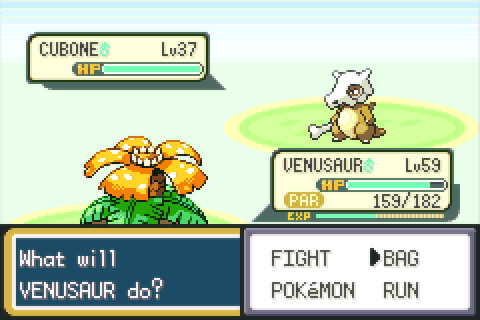
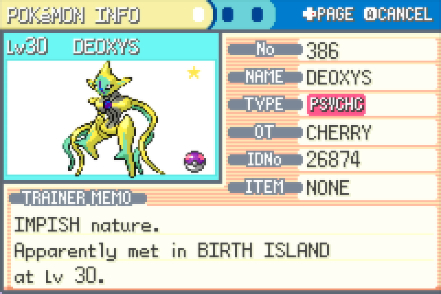
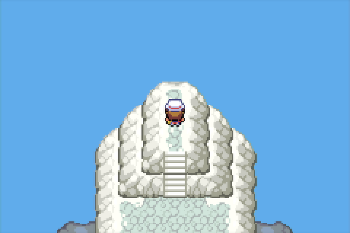
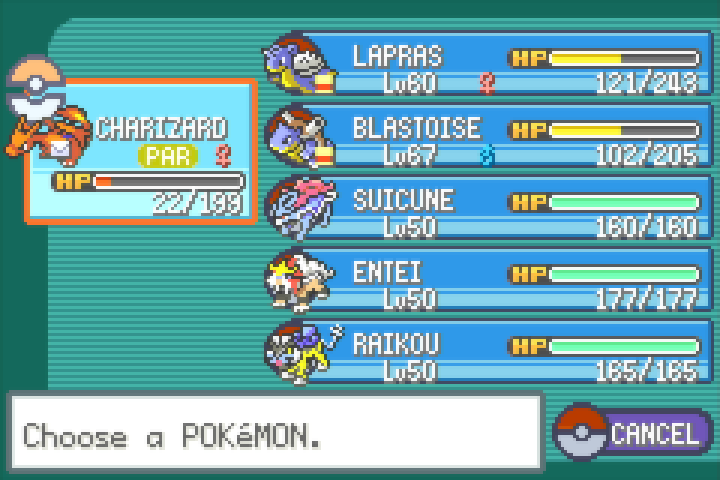
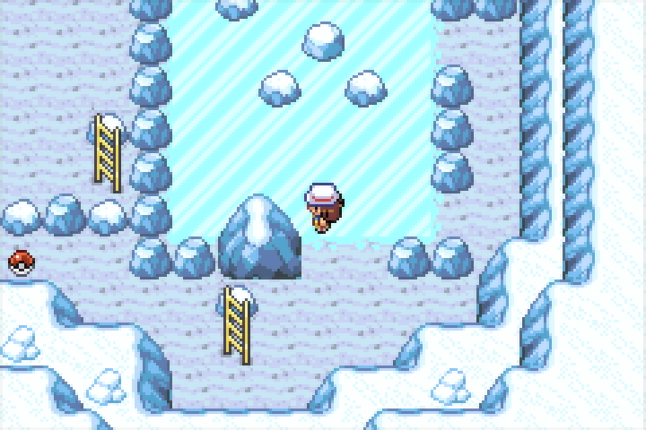
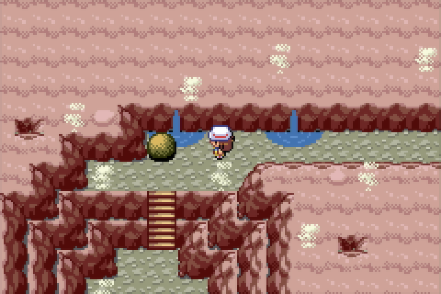
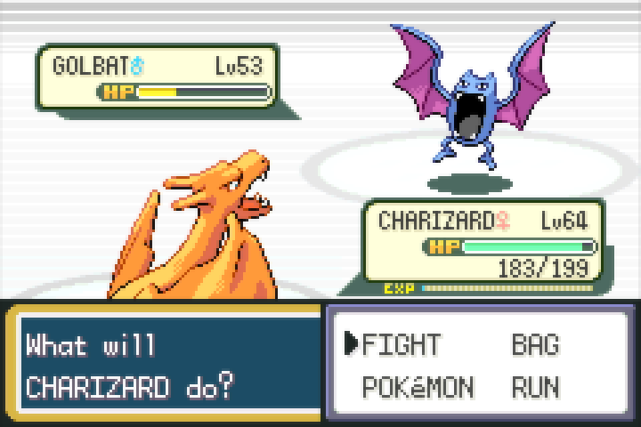
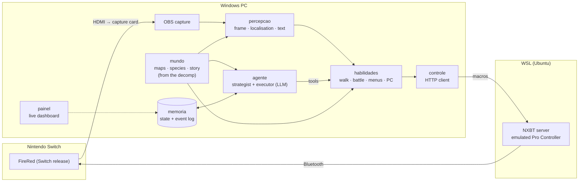
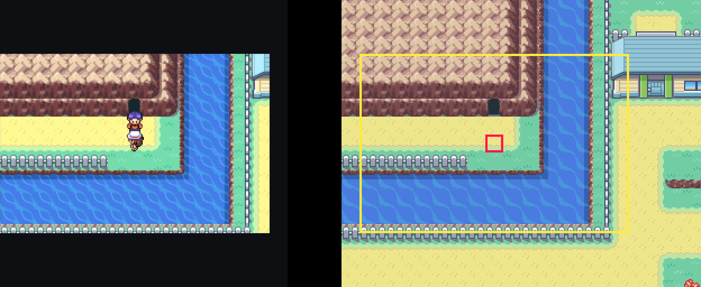
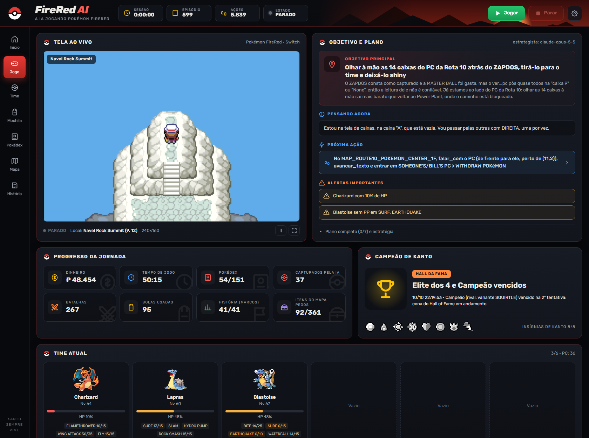

<div align="center">

# FireRed AI · Switch

**An AI that plays Pokémon FireRed on a real Nintendo Switch.**
It sees the game through a capture card and plays it through an emulated Bluetooth Pro Controller,
with no emulator, no ROM and no reading of game memory.

[](https://github.com/xhinzz/firered-ai-switch/actions/workflows/ci.yml)


[](LICENSE)

**[▶ Watch the whole campaign replayed event by event](https://xhinzz.github.io/firered-ai-switch/)**

[Português](README.pt-BR.md) · [Architecture](docs/architecture.md) · [Setup](docs/setup.md) · [ACE & post-game](docs/ace.md) · [Campaign log](docs/campanha.md)



</div>

---

## What it does

- **Beat the game on real hardware.** The agent took over a save at Route 4 (one badge, 2h53 of play) and played
  it to the Champion: the other 7 badges, Elite Four and Champion. That took 597 agent episodes and 5,792 tool
  actions on a Switch 2 running the official Switch release of FireRed. The numbers come from the agent's own diary
  ([campaign log](docs/campanha.md)).
- **Pixels in, button presses out.** Every decision is based on the 240×160 frame. Position on the map, menus, HP
  bars, text and Pokémon species are all read off the screen.
- **Game knowledge without shipping the game.** Maps, collision, doors, wild encounters, species, moves and the
  in-game font are parsed at runtime from the [pret/pokefirered](https://github.com/pret/pokefirered) decompilation,
  which is downloaded on setup.
- **LLM where judgement matters, code where speed matters.** A strategist model plans, an executor model plays the
  plan through about 60 tools, and deterministic skills handle walking, battling, catching and menus on their own.
- **Post-game by script, with arbitrary code execution.** An ACE toolkit (Mail glitch, code written as PC box names)
  plus scripted missions caught and turned shiny **Mewtwo, Suicune, Entei, Raikou, Ho-Oh, Lugia and Deoxys**.

<table>
<tr>
<td><br><sub>Shiny Deoxys after the Birth Island puzzle</sub></td>
<td><br><sub>Navel Rock summit, right after Ho-Oh</sub></td>
<td><br><sub>Suicune, Entei and Raikou caught via ACE</sub></td>
</tr>
<tr>
<td><br><sub>Icefall Cave: slides on the ice floor</sub></td>
<td><br><sub>Ruby Path: Strength boulder puzzle</sub></td>
<td><br><sub>Rocket Warehouse, Team Rocket admin</sub></td>
</tr>
</table>

## How it works



| Layer | Package | Responsibility |
|---|---|---|
| Perception | `fireredia.percepcao` | Captures OBS, crops the GBA screen, classifies it (map, battle menu, dialog, yes/no...), locates the player on any of the 309 map layouts and reads text with the game's own font. |
| Control | `fireredia.controle` | HTTP client for the NXBT server that runs in WSL and owns the Bluetooth dongle. |
| World | `fireredia.mundo` | Everything the game "knows": maps, connections, warps, NPCs, wild tables, species, moves, damage and catch formulas, the story route and the gates it closes. |
| Skills | `fireredia.habilidades` | Path finding across the whole world (doors, ledges, surf, Strength, Cut...), executed and corrected frame by frame; wild-battle autopilot; trainer battles by simulation; menus, bag, PC, shops. |
| Agent | `fireredia.agente` | LLM episodes in two roles: the **strategist** reads the memory and writes a plan, the **executor** plays it with ~60 tools. Claude via the Agent SDK; GPT and Gemini through the same tools. |
| Memory | `fireredia.estado` | `estado.json` (what is true now) and an append-only `eventos.jsonl` (every decision, battle, item and map change). |
| ACE & missions | `fireredia.ace`, `fireredia.missoes` | Arbitrary code execution through PC box names, plus scripted post-game missions. |



*Localisation: the frame from the Switch (left) is matched against maps rendered from the decomp. The yellow box is
the matched viewport and the red square is the player's tile.*

More detail, including the design decisions and the game rules that had to be reproduced: **[docs/architecture.md](docs/architecture.md)**.

## The dashboard



`python -m fireredia` starts the controller, the dashboard at `http://127.0.0.1:8770` and the agent loop. The
dashboard also works as an OBS browser source.

## Getting started

You need a Windows PC, a Nintendo Switch with FireRed (the 2026 eShop release), an HDMI capture card, a USB
Bluetooth dongle that can be passed to WSL, and an LLM provider key or a Claude Code login. Step by step: **[docs/setup.md](docs/setup.md)**.

```powershell
git clone https://github.com/xhinzz/firered-ai-switch
cd firered-ai-switch
py -3.13 -m venv .venv
.venv\Scripts\pip install -e ".[dev,painel]"
.venv\Scripts\python scripts\baixar_decomp.py   # ~40 MB of the pret/pokefirered decomp
copy .env.exemplo .env                           # provider, models, machine settings
.venv\Scripts\python -m fireredia                # the AI plays
```

Other entry points:

```powershell
python -m fireredia.painel.app                 # dashboard in its own window (Play / Stop buttons)
python -m fireredia.missoes plano-deoxys       # offline: compute the Deoxys triangle route
python -m fireredia.missoes deoxys             # play it: save, 11 touches, Master Ball
python -m fireredia.ace codigos                # stored ACE codes
python -m fireredia.ace gerar "Start wild battle with any Pokemon" --set PokemonHex=0xF5 --set PokemonLV=50
python -m fireredia.ace digitar WILD_SUICUNE   # type the code into PC boxes 1-11, checking every key
python -m fireredia.ace disparar               # check boxes 13/14, save, trigger the code
```

## Project layout

```
fireredia/
├── percepcao/     olhos.py (capture, classify, localise) · texto.py (game font reader)
├── controle/      maos.py (client) · servidor_wsl.py (NXBT server, runs as root in WSL)
├── mundo/         mapa.py · conhecimento.py · roteiro.py
├── habilidades/   navegacao.py · batalha.py · combate.py · piloto.py · menus.py · coleta.py
├── agente/        cerebro.py (episodes) · ferramentas.py (tools) · provedores.py (GPT, Gemini)
├── ace/           teclado · caixas · disparo · codigos · gerador · mail_glitch
├── missoes/       planos (pure planning) · viagem · balsa · lendarios · gelo · navel_rock · deoxys · pc
├── painel/        dashboard (HTTP + HTML) and desktop window
├── contexto.py    navigator wired to the campaign memory
├── estado.py      memory
└── jogar.py       `python -m fireredia`
dados/             walkthrough written for the agent, UI templates (decomp downloaded here, not versioned)
scripts/           baixar_decomp.py · figuras.py · relatorio_campanha.py · gerar_site.py
tests/             offline tests, real Switch frames as fixtures
docs/              architecture, setup, ACE, campaign log
```

The code and its comments are in Portuguese, the language the project was built in. The documentation is in
English and Portuguese.

## Tests

```powershell
pytest        # 36 tests, ~15 s, no Switch needed
ruff check . ; ruff format --check .
```

The tests run offline. Pure planning (the Deoxys puzzle, ice sliding) runs on synthetic grids. Navigation rules run
on the real decomp maps. Perception runs on frames captured from the Switch during the campaign (`tests/fixtures`):
localisation on six maps, screen classification, dialog OCR, the shiny star and the PC panel. CI runs the same suite
on Windows with the decomp downloaded and cached.

## Engineering notes

A few things that only show up on real hardware or in the game's source:

- **Lost inputs are normal.** Bluetooth latency drops button presses, especially during animations. Every multi-step
  action checks the screen before it commits: the battle cursor, the PC panel, the keyboard page and cursor while
  typing box names.
- **The map data is not the whole truth.** Scripts change metatiles (the Ruby Path entrance opens after a cutscene)
  and flags hide NPCs (the Cerulean Cave guard). The navigator models script-opened doors and takes a list of NPCs the
  story has already moved.
- **Reproduce the engine's rules, not your intuition.** Leaving Surf only works onto elevation-3 tiles
  (`CanStopSurfing`). Ice slides until it hits an obstacle. The Deoxys triangle has a step budget per touch
  (`sDeoxysStepCaps`). Each rule became code and a test.
- **Cost-aware agent loop.** Short episodes keep the image-heavy context small. The executor re-plans only every few
  episodes or when it stalls, and anything deterministic (walking, wild battles, menus) never calls the model.

## Limitations

- Windows only (screen capture uses Win32). The GBA crop is calibrated for the Switch release shown in an OBS
  projector at 2560×1440 and can be adjusted in `percepcao/olhos.py` (`RECORTE`).
- The controller depends on NXBT and a Bluetooth dongle that WSL can own (usbipd). The Switch sometimes drops the
  link, and re-pairing needs the *Change Grip/Order* screen.
- ACE writes to the save, and this release has no save backup (no cloud saves, no save states). Every trigger here
  saves first and checks the boxes, but a wrong code can still crash the game or corrupt the save.

## Credits

- [pret/pokefirered](https://github.com/pret/pokefirered): the decompilation every map, table and font comes from.
- [NXBT](https://github.com/Brikwerk/nxbt): Switch controller emulation over Bluetooth.
- [E-Sh4rk's CodeGenerator](https://e-sh4rk.github.io/CodeGenerator/) and the FRLG ACE research by Sleipnir17,
  PapaJefé and others: the ACE codes and the setup route ([notes, in Portuguese](docs/ace-pesquisa.md)).

Pokémon and FireRed are trademarks of Nintendo, Game Freak and Creatures. This project ships no game code or
assets; the decomp is downloaded from its own repository, and the screenshots are from the author's own console.

## License

[MIT](LICENSE)
