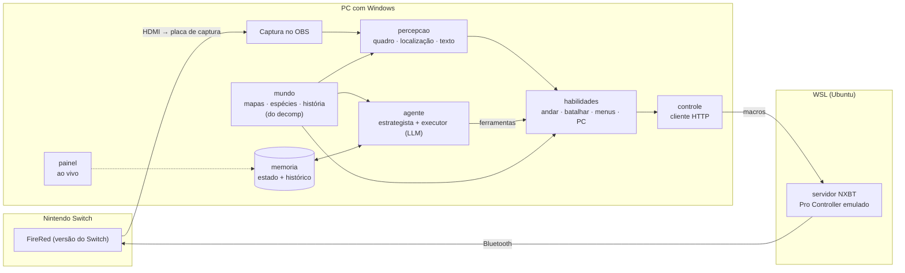

<div align="center">

# FireRed AI · Switch

**Uma IA que joga Pokémon FireRed num Nintendo Switch de verdade.**
Ela vê o jogo por uma placa de captura e joga por um Pro Controller emulado via Bluetooth,
sem emulador, sem ROM e sem ler a memória do jogo.

[](https://github.com/xhinzz/firered-ai-switch/actions/workflows/ci.yml)


[](LICENSE)

**[▶ Veja a campanha inteira reproduzida evento por evento](https://xhinzz.github.io/firered-ai-switch/)**

[English](README.md) · [Arquitetura](docs/pt-BR/arquitetura.md) · [Instalação](docs/pt-BR/instalacao.md) · [ACE e pós-jogo](docs/pt-BR/ace.md) · [Diário da campanha](docs/campanha.md)


</div>

---

## O que ela faz

- **Zerou o jogo em hardware real.** A IA assumiu um save na Rota 4 (uma insígnia, 2h53 de jogo) e jogou até o
  Campeão: as outras 7 insígnias, a Elite dos 4 e o Campeão. Foram 597 episódios e 5.792 ações num Switch 2, na
  versão oficial do FireRed para Switch. Os números saem do diário que a própria IA grava
  ([diário da campanha](docs/campanha.md)).
- **Entra pixel, sai botão.** Toda decisão parte do quadro de 240×160. Posição no mapa, menus, barras de HP, texto e
  espécie dos Pokémon são lidos da tela.
- **Conhecimento do jogo sem distribuir o jogo.** Mapas, colisão, portas, encontros selvagens, espécies, golpes e a
  fonte do jogo são lidos em tempo de execução do decomp [pret/pokefirered](https://github.com/pret/pokefirered),
  baixado na instalação.
- **Modelo de linguagem onde precisa de julgamento, código onde precisa de velocidade.** Um modelo estrategista
  planeja, um executor joga o plano com cerca de 60 ferramentas, e habilidades determinísticas andam, batalham,
  capturam e usam menus sozinhas.
- **Pós-jogo por roteiro, com execução arbitrária de código.** Um kit de ACE (Mail glitch, código escrito nos nomes
  das caixas do PC) e missões roteirizadas capturaram e deixaram shiny **Mewtwo, Suicune, Entei, Raikou, Ho-Oh, Lugia
  e Deoxys**.

<table>
<tr>
<td><br><sub>Deoxys shiny depois do quebra-cabeça da Birth Island</sub></td>
<td><br><sub>Cume da Navel Rock, logo depois do Ho-Oh</sub></td>
<td><br><sub>Suicune, Entei e Raikou capturados via ACE</sub></td>
</tr>
<tr>
<td><br><sub>Icefall Cave: deslizando no chão de gelo</sub></td>
<td><br><sub>Ruby Path: quebra-cabeça de pedras (Strength)</sub></td>
<td><br><sub>Rocket Warehouse, admin da Equipe Rocket</sub></td>
</tr>
</table>

## Como funciona



| Camada | Pacote | Responsabilidade |
|---|---|---|
| Percepção | `fireredia.percepcao` | Captura o OBS, recorta a tela do GBA, classifica (mapa, menu de batalha, diálogo, sim/não...), localiza o jogador em qualquer um dos 309 layouts de mapa e lê texto com a fonte do próprio jogo. |
| Controle | `fireredia.controle` | Cliente HTTP do servidor NXBT, que roda no WSL e controla o adaptador Bluetooth. |
| Mundo | `fireredia.mundo` | Tudo o que o jogo "sabe": mapas, conexões, portas, NPCs, tabelas de selvagens, espécies, golpes, fórmulas de dano e captura, o roteiro da história e os bloqueios que ela impõe. |
| Habilidades | `fireredia.habilidades` | Caminho entre quaisquer dois pontos do mundo (portas, degraus, Surf, Strength, Cut...), executado e corrigido quadro a quadro; piloto automático de selvagens; batalha contra treinador por simulação; menus, mochila, PC, lojas. |
| Agente | `fireredia.agente` | Episódios do modelo em dois papéis: o **estrategista** lê a memória e escreve o plano, o **executor** joga com cerca de 60 ferramentas. Claude pelo Agent SDK; GPT e Gemini com as mesmas ferramentas. |
| Memória | `fireredia.estado` | `estado.json` (o que vale agora) e `eventos.jsonl`, só de acréscimo (cada decisão, batalha, item e troca de mapa). |
| ACE e missões | `fireredia.ace`, `fireredia.missoes` | Execução arbitrária de código pelos nomes das caixas do PC e missões roteirizadas do pós-jogo. |


*Localização: o quadro do Switch (à esquerda) é comparado com os mapas desenhados a partir do decomp. O retângulo
amarelo é a janela encontrada e o quadrado vermelho, o tile do jogador.*

Mais detalhes, inclusive as decisões de projeto e as regras do jogo que precisaram ser reproduzidas:
**[docs/pt-BR/arquitetura.md](docs/pt-BR/arquitetura.md)**.

## O painel


`python -m fireredia` sobe o controle, o painel em `http://127.0.0.1:8770` e o laço do agente. O painel também
funciona como fonte de navegador no OBS.

## Como começar

Você precisa de um PC com Windows, um Nintendo Switch com o FireRed (versão da eShop de 2026), uma placa de captura
HDMI, um adaptador Bluetooth USB que possa ser repassado ao WSL e uma chave de API (ou o login do Claude Code). Passo a
passo: **[docs/pt-BR/instalacao.md](docs/pt-BR/instalacao.md)**.

```powershell
git clone https://github.com/xhinzz/firered-ai-switch
cd firered-ai-switch
py -3.13 -m venv .venv
.venv\Scripts\pip install -e ".[dev,painel]"
.venv\Scripts\python scripts\baixar_decomp.py   # ~40 MB do decomp pret/pokefirered
copy .env.exemplo .env                           # provedor, modelos e ajustes da máquina
.venv\Scripts\python -m fireredia                # a IA joga
```

Outros pontos de entrada:

```powershell
python -m fireredia.painel.app                 # painel numa janela própria (botões Jogar / Parar)
python -m fireredia.missoes plano-deoxys       # offline: calcula a rota do triângulo do Deoxys
python -m fireredia.missoes deoxys             # joga: salva, 11 toques, Master Ball
python -m fireredia.ace codigos                # códigos ACE guardados
python -m fireredia.ace gerar "Start wild battle with any Pokemon" --set PokemonHex=0xF5 --set PokemonLV=50
python -m fireredia.ace digitar WILD_SUICUNE   # digita o código nas caixas 1-11, conferindo cada tecla
python -m fireredia.ace disparar               # confere as caixas 13/14, salva e dispara o código
```

## Estrutura

```
fireredia/
├── percepcao/     olhos.py (captura, classifica, localiza) · texto.py (leitor com a fonte do jogo)
├── controle/      maos.py (cliente) · servidor_wsl.py (servidor NXBT, roda como root no WSL)
├── mundo/         mapa.py · conhecimento.py · roteiro.py
├── habilidades/   navegacao.py · batalha.py · combate.py · piloto.py · menus.py · coleta.py
├── agente/        cerebro.py (episódios) · ferramentas.py · provedores.py (GPT, Gemini)
├── ace/           teclado · caixas · disparo · codigos · gerador · mail_glitch
├── missoes/       planos (planejamento puro) · viagem · balsa · lendarios · gelo · navel_rock · deoxys · pc
├── painel/        painel (HTTP + HTML) e janela
├── contexto.py    navegador ligado à memória da campanha
├── estado.py      memória
└── jogar.py       `python -m fireredia`
dados/             detonado escrito para o agente, modelos de tela (o decomp é baixado aqui, fora do git)
scripts/           baixar_decomp.py · figuras.py · relatorio_campanha.py · gerar_site.py
tests/             testes offline, com telas reais do Switch como fixtures
docs/              arquitetura, instalação, ACE, diário da campanha
```

## Testes

```powershell
pytest        # 36 testes, ~15 s, sem precisar do Switch
ruff check . ; ruff format --check .
```

Os testes rodam offline. O planejamento puro (triângulo do Deoxys, deslize no gelo) usa grades sintéticas. As regras
de navegação usam os mapas reais do decomp. A percepção usa telas capturadas do Switch durante a campanha
(`tests/fixtures`): localização em seis mapas, classificação de tela, leitura de diálogo, estrela de shiny e painel do
PC. A CI roda a mesma bateria no Windows, com o decomp baixado e em cache.

## Notas de engenharia

Algumas coisas que só aparecem em hardware real ou no código-fonte do jogo:

- **Perder toque é normal.** A latência do Bluetooth derruba botões, principalmente durante animações. Toda ação de
  várias etapas confere a tela antes de confirmar: a setinha da batalha, o painel do PC, a página e o cursor do
  teclado ao digitar nomes de caixa.
- **O mapa do decomp não é a verdade toda.** Scripts trocam metatiles (a entrada do Ruby Path abre depois de uma cena)
  e flags escondem NPCs (o guarda da Cerulean Cave). O navegador modela portas abertas por script e recebe a lista de
  NPCs que a história já tirou do lugar.
- **Reproduza as regras do motor, não a intuição.** Só se sai do Surf para tiles de elevação 3 (`CanStopSurfing`). O
  gelo desliza até bater. O triângulo do Deoxys tem um limite de passos por toque (`sDeoxysStepCaps`). Cada regra virou
  código e teste.
- **Laço do agente atento ao custo.** Episódios curtos mantêm pequeno o contexto cheio de imagens. O executor só
  replaneja a cada poucos episódios ou quando trava, e tudo o que é determinístico (andar, selvagens, menus) nunca
  chama o modelo.

## Limitações

- Só Windows (a captura usa Win32). O recorte do GBA está calibrado para a versão do Switch num projetor do OBS em
  2560×1440 e pode ser ajustado em `percepcao/olhos.py` (`RECORTE`).
- O controle depende do NXBT e de um adaptador Bluetooth que o WSL consiga assumir (usbipd). O Switch às vezes derruba
  a conexão, e para parear de novo é preciso abrir *Alterar empunhadura/ordem*.
- O ACE escreve no save, e essa versão do jogo não tem backup de save (sem nuvem, sem save state). Todo disparo aqui
  salva antes e confere as caixas, mas um código errado ainda pode travar o jogo ou corromper o save.

## Créditos

- [pret/pokefirered](https://github.com/pret/pokefirered): a decompilação de onde vêm todos os mapas, tabelas e a
  fonte.
- [NXBT](https://github.com/Brikwerk/nxbt): emulação do controle do Switch por Bluetooth.
- [CodeGenerator do E-Sh4rk](https://e-sh4rk.github.io/CodeGenerator/) e a pesquisa de ACE em FRLG de Sleipnir17,
  PapaJefé e outros: os códigos e a rota de montagem ([notas](docs/ace-pesquisa.md)).

Pokémon e FireRed são marcas da Nintendo, Game Freak e Creatures. Este projeto não distribui código nem ROM
do jogo; o decomp é baixado do repositório dele. As capturas de tela e os sprites do site pertencem a eles e não estão
cobertos pela licença MIT; veja o [NOTICE](NOTICE.md).

## Licença

[MIT](LICENSE)
