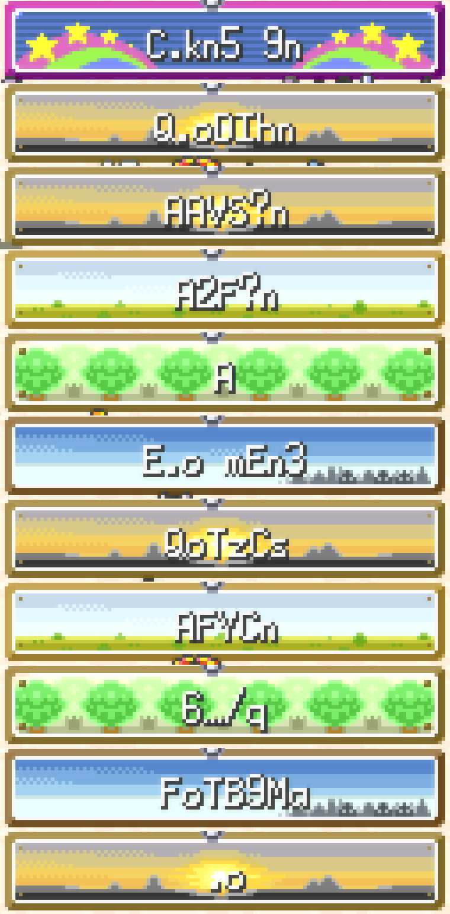
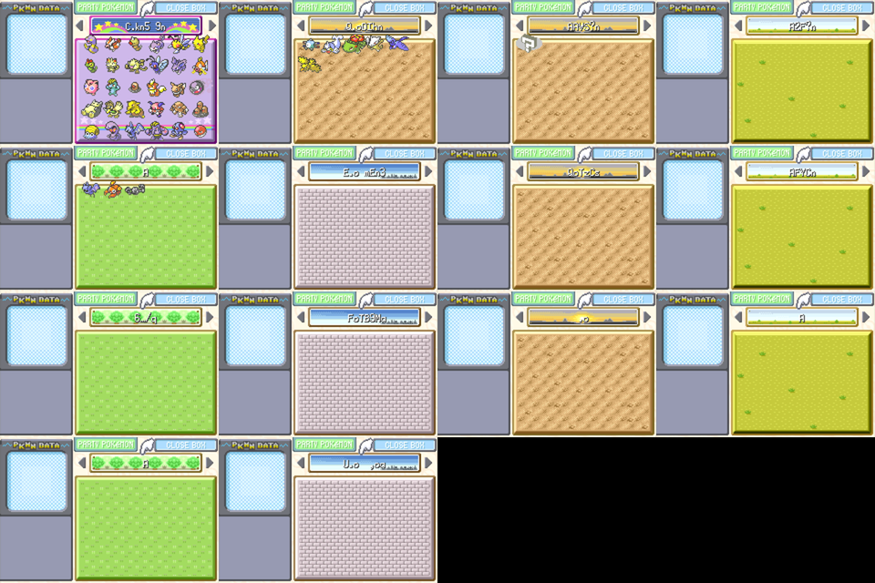
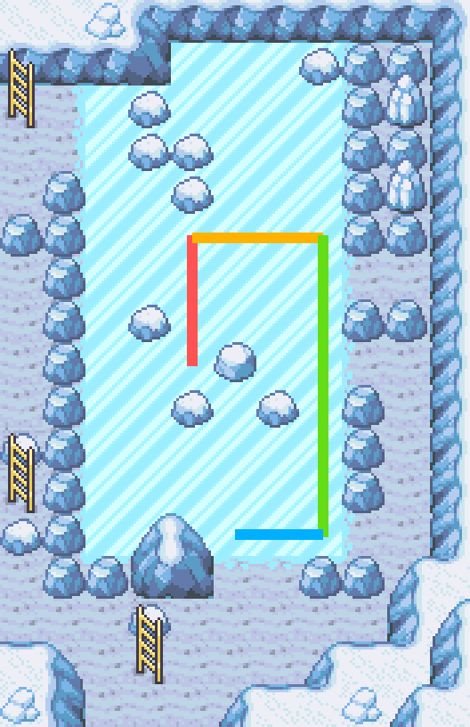
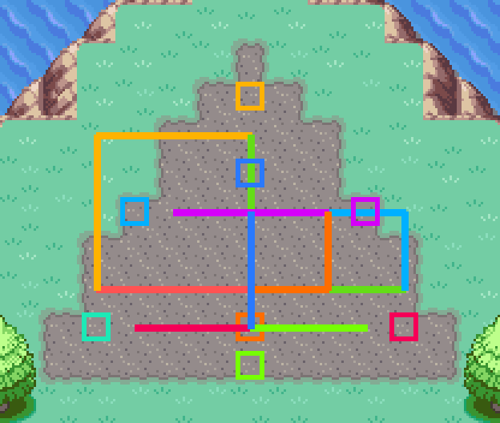

# ACE e missões do pós-jogo

[English](../ace.md)

Depois do Campeão, a campanha seguiu com roteiros determinísticos: a missão pós-jogo das Sevii, os lendários e a
**execução arbitrária de código (ACE)** para o que o jogo já não oferece. Isso significou mais Master Balls, os três
cães lendários e versões shiny de tudo o que foi capturado.

| Pokémon | Como | Shiny |
|---|---|---|
| Mewtwo | Cerulean Cave B1F depois da missão das Sevii, Master Ball | ACE |
| Suicune, Entei, Raikou | ACE *Start wild battle* por um NPC, Master Ball | ACE |
| Ho-Oh, Lugia | Navel Rock (MysticTicket), Master Ball | ACE |
| Deoxys | Quebra-cabeça do triângulo da Birth Island (AuroraTicket), Master Ball | ACE |


## Como o ACE funciona no FireRed

As notas de pesquisa, com fontes, estão em [ace-pesquisa.md](../ace-pesquisa.md). Resumindo:

1. O **Mail glitch** (Mr. Mime + Farfetch'd + Retro Mail numa batalha dupla) gera um Pokémon corrompido, que é
   convertido na espécie glitch **0x0351**.
2. Com a 0x0351 na Caixa 3, casa 1, uma "troca dupla com a mão laranja" no PC salta para a memória que guarda os
   **nomes das caixas do PC**.
3. Então **o programa é escrito digitando nomes de caixa**. Cada nome tem até 8 caracteres, e cada caractere é um byte
   de código ARM. O CodeGenerator do E-Sh4rk converte um programa nos 11 nomes, com uma rotina de saída que volta ao
   jogo sem travar.

Neste save o gatilho é o Weedle da Caixa 1, casa 3, trocado duas vezes com a 0x0351.



*Caixas 1–11 com o código "Make any Pokémon shiny" (alvo: Caixa 10, casa 2).*

## O fluxo seguro

Digitar no Switch perde teclas, e um byte errado pode travar o jogo ou estragar o save. Por isso cada etapa confere a
tela:

| Etapa | Comando | Conferências |
|---|---|---|
| Gerar | `python -m fireredia.ace gerar "<código>" --set Nome=valor` | Baixa o motor e o catálogo do E-Sh4rk para `dados/gerador/` (fora do git) e roda com o Node |
| Digitar | `python -m fireredia.ace digitar <CÓDIGO>` | Para cada caractere: a página do teclado (cor de fundo), a posição do cursor (o contorno que pisca) e só então A. Cada caixa é fotografada, e uma tira com os 11 títulos fica salva para revisão |
| Trocar | `python -m fireredia.ace trocar <ANTIGO> <NOVO>` | Redigita só as caixas que mudam (os códigos dos três cães diferem só na Caixa 4) |
| Conferir | `python -m fireredia.ace conferir` | A Caixa 13 da casa 7 em diante e a Caixa 14 precisam estar vazias, porque o código passa por elas; uma sobra da conversão (Bad Egg) aparece ali |
| Disparar | `python -m fireredia.ace disparar` | Confere as caixas 13/14, **salva**, confere no painel do PC que o Weedle está na mão antes e depois da troca dupla e o devolve à casa |
| Shiny | `python -m fireredia.ace shiny MEWTWO` | Leva o Pokémon à Caixa 10, casa 2, salva, dispara, abre o resumo, confere a **estrela de shiny** e o traz de volta ao time |

Códigos guardados (`python -m fireredia.ace codigos`): `SHINY`, `ITEM_MASTER` (5 Master Balls no PC de itens),
`ITEM_CANDY`, `WILD_SUICUNE` / `WILD_ENTEI` / `WILD_RAIKOU` (o NPC 2 do mapa atual abre uma batalha de nível 50),
`GIFT_*`, `IVS_*`, `LER_*` (diagnóstico). O gerador reproduz todos exatamente. Por exemplo,
`gerar "Start wild battle with any Pokemon" --set PokemonHex=0xF5 --set PokemonLV=50` produz o `WILD_SUICUNE`.



## Missões

`python -m fireredia.missoes <missão>`, com o jogo aberto. Toda captura salva antes, então uma batalha que dá errado
nunca custa o Pokémon.

### Missão pós-jogo das Sevii (jogada passo a passo sobre as ferramentas de missão)

O guarda da Cerulean Cave só sai depois que a Network Machine do Celio funciona. Para isso foram precisos o Ruby (Mt.
Ember, Ruby Path), o Rainbow Pass, o Sapphire (Dotted Hole, Six Island) e o Rocket Warehouse (Five Island). Duas
dependências não eram óbvias e saíram do decomp:

- O cientista que bloqueia a porta do Dotted Hole (`SixIsland_RuinValley`) é escondido por uma flag que só é ligada
  depois do resgate da Lorelei na **Icefall Cave**, e esse resgate precisa de **Waterfall**, cuja HM está dentro da
  mesma caverna.
- A porta do Dotted Hole só abre com **Cut** usado do tile (24,25), olhando para o norte (`CutMoveRuinValleyCheck`).

O navegador precisou de duas correções de regra para passar:
- a entrada do Ruby Path é uma porta aberta por script;
- só se sai do Surf para elevação 3.

Os quebra-cabeças de pedra foram resolvidos pelo `plano_da_pedra`.

### Icefall Cave: gelo fino e deslize (`missoes/gelo.py`)

No primeiro andar, pisar duas vezes no gelo fino derruba para o B1F. No B1F o chão é de gelo e se desliza até bater
em algo. `planos.plano_gelo` é uma busca em largura sobre os pontos de parada; o caminho até a escada da HM07 são
quatro deslizes:



### Navel Rock (`missoes/navel_rock.py`)

O caminho até o Ho-Oh (4 salas) e até o Lugia (11 salas) é uma sequência de salinhas 3×3 idênticas, então a tela não
diz em que andar se está. Cada escada leva à escada da *mesma* posição no andar seguinte. Por isso o andador entra por
um canto, sai pelo oposto, alterna e conta as salas. O corredor longo do Fork é uniforme demais para localizar, então
é atravessado correndo até a parede.

### Birth Island: o triângulo do Deoxys (`missoes/deoxys.py`)

Tocar o triângulo o leva para a próxima de 10 posições. Se você der mais passos que um limite fixo antes do próximo
toque (`sDeoxysStepCaps`: 4, 8, 8, 8, 4, 4, 4, 6, 3, 3), ele volta ao início. O 11º toque abre a batalha.
`planos.plano_deoxys` é uma busca em profundidade sobre o lado de onde se toca, porque esse lado decide a distância até
a próxima posição. O plano usa todos os limites exatamente, e funcionou de primeira:



```
$ python -m fireredia.missoes plano-deoxys
toque  2: triângulo em (11, 14), 4 passos ['ESQUERDA', 'ESQUERDA', 'ESQUERDA', 'ESQUERDA'] -> BAIXO
toque  3: triângulo em (15, 8), 8 passos ['CIMA', 'CIMA', 'CIMA', 'CIMA', 'DIREITA', 'DIREITA', 'DIREITA', 'DIREITA'] -> CIMA
...
toque 11: triângulo em (15, 10), 3 passos ['CIMA', 'CIMA', 'CIMA'] -> CIMA
```

### Todas as missões

| Comando | O que faz |
|---|---|
| `plano-deoxys` | Mostra o plano do triângulo (offline) |
| `deoxys` | Salva, faz os 11 toques conferindo a posição a cada trecho e joga a Master Ball |
| `mewtwo` | Cerulean Cave B1F, Master Ball |
| `ho-oh`, `lugia` | Fork → salinhas de escada → cume / base → captura |
| `npc-viridian` | Depois de disparar um código `WILD_*` no Centro Pokémon de Viridian: fala com o senhor e joga a Master Ball |
| `balsa <DESTINO>` | Balsa Seagallop para `VERMILION`, `ONE`…`SEVEN`, `NAVEL` ou `BIRTH`, lendo os menus na tela |
| `guardar <ESPÉCIE> <CAIXA>` | Leva um Pokémon do time para a casa 3 de uma caixa |
| `ir <MAPA> <X> <Y>` | Anda até lá fugindo de selvagens e lutando com treinadores |
